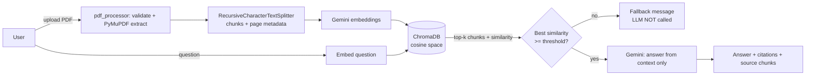
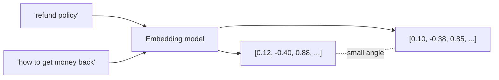

# DocuMind AI — Chat with Your PDF

A Streamlit app that answers questions **strictly from an uploaded PDF** using Retrieval-Augmented Generation (RAG):
PyMuPDF → `RecursiveCharacterTextSplitter` → Gemini embeddings → ChromaDB → relevance gate → Gemini answer with page citations.

## Problem and solution
LLMs hallucinate when asked about documents they have not seen, and sending a whole PDF to the model is costly and hits context limits.
DocuMind retrieves only the top-k relevant chunks, refuses to answer when retrieval looks weak, and shows the evidence for every answer.

## Features
- PDF upload with validation (type, size, page limit, corrupt, password-protected, empty)
- Clear message for scanned PDFs (**OCR is not implemented**)
- Configurable chunk size/overlap, top-k and relevance threshold (sidebar + `.env`)
- Page + filename metadata preserved on every chunk; citations like `[Source: file.pdf, page 3]`
- Expandable "retrieved source chunks" with similarity scores
- Per-document ChromaDB collection (no leakage between PDFs); no re-embedding on Streamlit reruns
- Bounded retries with exponential backoff; user-safe error messages (no keys or stack traces)
- 31 offline unit tests (Gemini is mocked)

## Architecture


## RAG pipeline in one paragraph
Index time: extract text per page → split into chunks → embed each chunk → store vector + metadata in Chroma.
Query time: embed question → nearest-neighbour search → check best similarity → build prompt containing only retrieved chunks → Gemini answers or declines.

## Tech stack
Python 3.10+ · Streamlit · LangChain (`langchain-google-genai`, `langchain-chroma`, `langchain-text-splitters`) · ChromaDB · PyMuPDF · python-dotenv · pytest.
Pinned in `requirements.txt` (resolved together on Python 3.12).

**Model notes:** chat model defaults to `gemini-3.5-flash` and embeddings to `gemini-embedding-001`. Both are env-configurable (`CHAT_MODEL`, `EMBEDDING_MODEL`).
Model availability depends on your API key/region; if one is unavailable, change it in `.env` — no code change needed. Do not mix embedding models within one index (vectors from different models are not comparable).

## Project structure
```
documind-ai/
├── app.py              # Streamlit UI + session handling
├── config.py           # Settings from env/.env
├── pdf_processor.py    # validation, extraction, chunking
├── rag_pipeline.py     # embeddings, Chroma, retrieval gate, generation, retries
├── requirements.txt  .env.example  .gitignore  README.md  INTERVIEW_NOTES.md
├── docs/similarity_demo.py   # cosine vs Euclidean demo
├── tests/              # test_pdf_processor.py, test_rag_pipeline.py, helpers.py (fakes)
└── sample_data/README.md
```

## Setup
Prerequisites: Python 3.10+ and a Gemini API key from https://aistudio.google.com/apikey (Google AI Studio → Create API key).

**Windows PowerShell**
```powershell
cd documind-ai
python -m venv venv
.\venv\Scripts\Activate.ps1      # if blocked: Set-ExecutionPolicy -Scope Process -ExecutionPolicy Bypass
pip install -r requirements.txt
copy .env.example .env           # then open .env and paste your key
streamlit run app.py
```
**macOS / Linux**
```bash
cd documind-ai && python3 -m venv venv && source venv/bin/activate
pip install -r requirements.txt && cp .env.example .env   # edit .env
streamlit run app.py
```
`.env` must contain `GOOGLE_API_KEY=...`. It is git-ignored; never commit it.

## Run tests
```bash
python -m pytest -q          # offline, no API credits used
python docs/similarity_demo.py
```
Tests cover extraction, empty/scanned/encrypted/corrupt PDFs, chunking + overlap + metadata, retrieval ranking, no-context fallback (LLM not called), retry/backoff bounds, key-leak checks and document isolation.
They do **not** call the real Gemini API — verify that manually with the checklist below.

## Manual test checklist (use any 3+ page text PDF)
| # | Scenario | Expected |
|---|---|---|
| 1 | Open app with no key | Red "API key missing" message, chat disabled |
| 2 | Upload `.pdf` | Name, pages, chunk count shown; chat enabled |
| 3 | Ask a fact that is in the PDF | Short answer + `[Source: file, page N]`; expander shows chunks |
| 4 | Ask something unrelated ("Who won the 2010 World Cup?") | Fallback sentence; no hallucinated answer |
| 5 | Ask about something only partly covered | Answer marks interpretation separately, or declines |
| 6 | Press Enter on empty question | Nothing sent / warning |
| 7 | Upload scanned PDF | "OCR is not supported" message |
| 8 | Upload encrypted / corrupt / renamed `.txt` | Specific friendly error |
| 9 | Upload a second PDF | Chat cleared; answers only from new PDF |
| 10 | Change k or threshold | Applies instantly, no re-embedding |
| 11 | Invalid key in `.env` | "API key invalid" message, no key shown |

## Example questions
- In the document: "What is the notice period mentioned in section 4?" → answer with page citation.
- Not in the document: "What is the CEO's favourite food?" → *"I couldn't find sufficient information to answer this question in the uploaded document."*

## How vector search works
**Embedding.** A model maps text to a fixed-length list of numbers (a vector) so that texts with similar meaning land near each other. "Car" and "automobile" get nearby vectors; "banana" does not.



**Cosine similarity** = `(a·b) / (|a||b|)`: the cosine of the angle between vectors; ignores length. 1 = same direction, 0 = unrelated.
**Euclidean distance** = straight-line distance; affected by length.
Example from `docs/similarity_demo.py`, query `(1,1)`: vector A `(10,10)` has cosine 1.000 but Euclidean 12.73; vector B `(1.5,0.2)` has cosine 0.794 but Euclidean 0.94.
Cosine ranks A first, Euclidean ranks B first. If all vectors are normalised to unit length, the two give the same ranking (`|a−b|² = 2 − 2cos`). They do **not** always agree otherwise.

**How Chroma ranks.** Chroma uses an HNSW approximate-nearest-neighbour index. We create the collection with `hnsw:space = cosine`, so it returns *distance = 1 − cosine similarity*; smallest distance ranks first. The app converts back to similarity (`1 − distance`) for display and thresholding. HNSW is approximate, so on very large collections the true nearest chunk can occasionally be missed.

**Chunk size and overlap.** Too large: chunks mix topics, embeddings get blurry, prompts get expensive. Too small: a chunk loses context (a sentence about "it" with no subject). Overlap (default 150 of 1000 chars) stops a fact from being cut in half at a boundary, at the cost of some duplicate storage.

**Retrieval error vs generation error.** Retrieval error: the right chunk was never fetched (bad chunking, vague question, weak embeddings). Generation error: the right chunk was fetched but the LLM misread, over-generalised or ignored it. A relevant *document* can still give a wrong answer for either reason — which is why the UI shows the retrieved chunks so a human can tell which one failed.

## How hallucinations are reduced
1. Only retrieved chunks are sent to the model, never general knowledge sources.
2. **Retrieval gate:** if the best chunk's cosine similarity < `MIN_SIMILARITY`, the LLM is not called at all.
3. Strict system prompt (answer only from context, fixed fallback sentence, no invented names/numbers/quotes, separate "Interpretation:").
4. `temperature=0`.
5. Prompt-injection guard: context is declared untrusted.
6. API failures raise errors; the app never "guesses" an answer.
7. Citations + visible source chunks make answers checkable.

## Limitations
- **Threshold is heuristic.** Similarity scores depend on the embedding model, distance metric, language and document type. The default `0.45` is a starting point, **not calibrated**; tune it on your own PDFs. Too high → refuses answerable questions; too low → lets weak context through. A high similarity also does not prove the chunk actually answers the question.
- No OCR: scanned PDFs are rejected. Tables/multi-column layouts may extract in odd order.
- Questions that need the whole document ("summarise everything") work poorly with top-k retrieval.
- The "declined" detection checks for the fallback sentence; the LLM may paraphrase a refusal.
- Chroma runs in memory per session; the index is lost on restart (by design, avoids stale data).
- Chat history is shown but not fed back to the model, so follow-ups like "and the second one?" lack context.
- Live Gemini behaviour (model names, quotas) is not covered by the automated tests.

## Security
Keys are loaded from `.env`, never logged, never shown (errors are classified and replaced with generic messages). `.env` and PDFs are git-ignored. Uploaded PDFs are processed in memory only. Document text is sent to Google's Gemini API — do not upload confidential files unless that is acceptable.

## Future improvements
OCR for scans, conversational query rewriting, hybrid (BM25 + vector) search, reranking, persistent multi-document store, streaming answers, answer-faithfulness evaluation (RAGAS-style).
